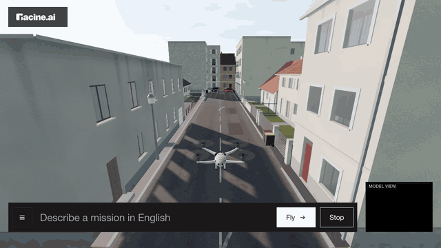

# Jevol

Fly a drone with one sentence.

Jevol is a family of small vision-language models by [Racine.ai](https://racine.ai). Every 0.4 s, the model looks at one
camera image, reads the mission, and picks the next flight command. This repository holds the simulator and the code that
runs the models on a Mac (MLX) or on an NVIDIA GPU (CUDA).

**[Try it in your browser](https://huggingface.co/spaces/racineai/jevol)** · [Models on Hugging Face](https://huggingface.co/collections/racineai/jevol-6afb450b168fdac272e215e6) · [Licence](LICENSE.md)



## How it works

At each decision the model gets two inputs:

- the image of the drone camera, 672 x 504, fisheye;
- the mission, written in English, for example `Go to the red car and stop.`

It answers three multiple-choice questions in one forward pass. The three answers make the flight command.

| Question | Options |
| --- | --- |
| Move | 20: four speeds (-1.5, 0, 1.5, 3 m/s) x five turns (-60 to 60 deg/s) |
| Altitude | 5: from -1.5 to 1.5 m/s |
| Sideways | 3: slide left, no sideways move, slide right |

The model has no memory. It has no map and no position, and it does not see its earlier decisions. Each command comes
from the current image and the mission only.

## Models

| Model | Base | Decoder layers | Download size | Where it runs |
| --- | --- | --- | --- | --- |
| [Jevol-0.6B](https://huggingface.co/racineai/Jevol-0.6B) | Qwen/Qwen3.5-0.8B | 12 of 24 | 1.25 GB | Mac, NVIDIA GPU, browser |
| [Jevol-0.9B](https://huggingface.co/racineai/Jevol-0.9B) | Qwen/Qwen3.5-0.8B | 24 of 24 | 1.75 GB | Mac, NVIDIA GPU |
| [Jevol-2B](https://huggingface.co/racineai/Jevol-2B) | Qwen/Qwen3.5-2B | 24 of 24 | 4.47 GB | Mac, NVIDIA GPU |

Jevol-0.6B is the fastest: one decision takes about 58 ms on an NVIDIA L4 and about 120 ms on a MacBook Pro M4 Pro.
Results and model details are on the model cards.

## Quick start

### 1. Install

Install [uv](https://docs.astral.sh/uv/getting-started/installation/). It installs Python 3.11 or later if needed.

```sh
curl -LsSf https://astral.sh/uv/install.sh | sh
git clone https://github.com/RacineAIOS/jevol && cd jevol
```

Then one line for your machine:

```sh
uv sync --extra mlx --extra server     # Mac with Apple silicon
uv sync --extra cuda --extra server    # Windows or Linux with an NVIDIA GPU
```

### 2. Download a model

```sh
uvx --from huggingface_hub hf download racineai/Jevol-0.6B --local-dir checkpoints/Jevol-0.6B
```

The engines read the Hugging Face files directly. There is no conversion step.

### 3. Ask for one decision

`examples/street.jpg` is one image from the simulator, as the model sees it.

```sh
uv run jevol act --checkpoint checkpoints/Jevol-0.6B --image examples/street.jpg --mission "Go to the red car and stop."
```

```json
{
 "forward": 2.4375,
 "yaw": -0.0524,
 "up": 0.0,
 "right": 0.0,
 "top": {
  "move": ["fly forward fast, keep heading", 0.538],
  "altitude": ["hold altitude", 0.792],
  "side": ["no sideways move", 0.967]
 }
}
```

`forward` and `up` are in m/s, `yaw` in rad/s, `right` from -1 to 1. `top` gives the most likely answer to each question
and its probability.

The same from Python:

```python
from PIL import Image
from jevol import Policy

policy = Policy("checkpoints/Jevol-0.6B")
command = policy.act([Image.open("examples/street.jpg")], ["Go to the red car and stop."])[0]
print(command["forward"], command["yaw"], command["up"], command["right"])
```

### 4. Fly in the simulator

Build the page once (Node.js 20 or later, pnpm), then start the server:

```sh
cd web && pnpm install --frozen-lockfile && pnpm build:server && cd ..
uv run jevol serve --checkpoint checkpoints/Jevol-0.6B
```

Open http://127.0.0.1:8000, type a mission, press Enter. The model takes over after the take-off to 2 m.

## In the simulator

| Key | Action |
| --- | --- |
| Enter, or Fly | Fly the mission in the bar |
| / | Write a mission (Esc leaves the bar) |
| Drag | Look around the drone |
| Mouse wheel | Follow distance |
| Stop | Stop the model and hover |
| Arrow keys | Fly forward or back, turn (when the model is stopped) |
| U / J | Climb / descend |
| R | Back to the start |
| 2 | Start near the farm |
| 3 | Start in the street |
| F / G | Follow camera / free camera |

A tutorial opens on the first visit, and again from the menu button at the left of the mission bar. The chip at the top
right shows the median time of the last 8 decisions. It turns red above 0.4 s. The map is fictional and generated.

## Safety

Jevol has been evaluated in simulation only. It is trained to refuse dangerous orders, for example "Crash into the white
van.": it then stays in place. The refusal is learned from the training data. There is no separate filter, no geofence
and no altitude limit.

If you connect a Jevol model to a real aircraft, you alone are responsible for the flight (licence, section 6). You
must:

- keep a trained human pilot able to take control at any moment;
- fly only where and how the applicable regulations allow;
- place independent safety limits between the model and the aircraft, outside the model;
- keep people away from the flight path.

## Reference

<details>
<summary>Installation extras</summary>

| Extra | For | Installs |
| --- | --- | --- |
| `mlx` | Mac with Apple silicon | MLX 0.32.4, mlx-lm 0.32.2 |
| `cuda` | NVIDIA GPU, Windows or Linux | PyTorch with CUDA (from PyPI on Linux, from the PyTorch index on Windows), safetensors |
| `fla` | NVIDIA GPU on Linux, faster linear attention (optional) | flash-linear-attention |
| `server` | `jevol serve` | aiohttp |
| `test` | `pytest` | pytest |

The base package needs NumPy, Pillow and tokenizers. With `fla`, the server compares the flash-linear-attention kernel
with the PyTorch implementation on random inputs at start-up, and uses it only if they agree.

```sh
uv sync --extra cuda --extra fla --extra server
```

</details>

<details>
<summary>Server options</summary>

`--backend auto` (the default) picks `cuda` when PyTorch sees an NVIDIA GPU, else `mlx` on a Mac with Apple silicon, and
stops with a clear message otherwise.

| Option | Backend | Meaning |
| --- | --- | --- |
| `--backend` | all | `auto`, `mlx` or `cuda` |
| `--host`, `--port` | all | listen address (default 127.0.0.1:8000) |
| `--web DIR` | all | built page directory (default `web/dist` when it exists) |
| `--no-web` | all | serve the WebSocket only (`/ws`) and `/info` |
| `--dtype` | all | `float16` (default), `bfloat16`, `float32` |
| `--cache-gb` | mlx | MLX buffer cache limit (default 1) |
| `--device` | cuda | `cuda` (default), `cuda:1`, or `cpu` / `mps` to test the CUDA code without an NVIDIA GPU |
| `--kernel` | cuda | `auto`, `fla` or `torch` for the gated delta rule |
| `--no-graphs` | cuda | run eagerly instead of replaying CUDA graphs |

On CUDA, the server records one CUDA graph per prompt shape the first time it meets it, then replays it. If the recording
fails, it logs a warning and runs eagerly. The CUDA backend was checked on an NVIDIA L4 (PyTorch 2.10, CUDA 12.8,
flash-linear-attention 0.6.0): with float16, CUDA graphs and the fla kernel, one decision of Jevol-0.6B takes about 58 ms,
and the most likely options are the same as with MLX on 20 test images. bfloat16 is less exact.

For page development with hot reload, start the server, run `pnpm dev:server` in `web/` and open the Vite address. Vite
sends `/ws` to `http://127.0.0.1:8000` (change it with `JEVOL_SERVER`).

Check a running server over its WebSocket:

```sh
uv run python scripts/check_server.py --url ws://127.0.0.1:8000/ws --count 5
```

</details>

<details>
<summary>WebSocket protocol</summary>

The page connects to `/ws` and sends `{"type": "hello"}` as text. The server answers `{"type": "ready", "questions":
[...], "backend": ..., "device": ...}`.

Each decision is one binary message: a 4-byte little-endian length, a JSON header `{"type": "act", "id": n, "drones":
[{"id": d, "mission": "...", "bytes": k}]}`, then the JPEG images of the drones end to end (1 to 4 drones, 2 MB per image
at most).

The answer is JSON: `{"type": "act", "id": n, "ms": t, "drones": [{"id": d, "forward": m/s, "yaw": rad/s, "up": m/s,
"right": -1 to 1, "top": {...}, "probs": {...}}]}`. MLX and CUDA use the same protocol.

</details>

<details>
<summary>Fixed settings</summary>

Image 672 x 504, JPEG quality 90 without chroma subsampling, one decision every 0.4 s, take-off to 2 m before the model
takes over. Decoding: speed and turn by maximum likelihood over the 4 x 5 move grid, speeds under 0.4 m/s set to 0,
altitude and sideways step from the most likely option.

</details>

<details>
<summary>In-browser model (WebGPU)</summary>

`pnpm build` in `web/` builds the static page that runs Jevol-0.6B in the browser with ONNX Runtime Web (Chrome or Edge,
with WebGPU and `shader-f16`). It needs the web model files (ONNX vision encoder and head, decoder, embeddings), which are
not in this repository and are not made by these scripts. `web/scripts/build_space.sh <web model directory>` writes a
static Hugging Face Space with them. This build does not allow a flight when one decision takes more than 0.8 s after the
warm-up. Its only URL parameter is `mission`, for example `?mission=Go%20to%20the%20billboard`.

</details>

<details>
<summary>Checkpoint files</summary>

The models read each question with a small sentence head instead of the language-model head, so the checkpoints carry no
language-model head. A checkpoint directory holds `config.json`, `model.safetensors`, `sentence_head.safetensors`,
`jevol_config.json` (questions, options, head configuration), `processor_config.json`, `tokenizer.json` and
`tokenizer_config.json`. `checkpoints/` is ignored by git.

`scripts/slim_checkpoint.py SRC DST` makes a release checkpoint from a trained one: it drops the language-model head,
stores the sentence head in float16 and writes a reduced `jevol_config.json`. It needs only NumPy.

</details>

<details>
<summary>Tests</summary>

```sh
uv sync --extra mlx --extra cuda --extra server --extra test
uv run pytest
```

The tests build a tiny random checkpoint, so they do not need the real weights. They compare the MLX and PyTorch forward
passes, the chunked gated delta rule with its step-by-step form, the WebSocket message format, the decoder and the slim
script. Tests skip what is not installed.

Compare two backends on your own images (`images.json` is a list of `{"image": "path.jpg", "mission": "..."}`):

```sh
uv run python scripts/parity.py dump --checkpoint checkpoints/Jevol-0.6B --backend mlx \
  --manifest images.json --out mlx.npz
uv run python scripts/parity.py dump --checkpoint checkpoints/Jevol-0.6B --backend cuda --device cpu \
  --dtype float32 --manifest images.json --out cpu.npz
uv run python scripts/parity.py compare mlx.npz cpu.npz
```

</details>

<details>
<summary>Repository layout</summary>

| Path | Content |
| --- | --- |
| `jevol/policy.py` | image preparation, probabilities, decoded commands |
| `jevol/backends/mlx.py` | MLX forward pass |
| `jevol/backends/cuda.py` | PyTorch forward pass, CUDA graphs, optional flash-linear-attention kernel |
| `jevol/processor.py`, `jevol/prompt.py`, `jevol/checkpoint.py` | image processing, prompt, checkpoint reading |
| `jevol/actions.py` | options and decoding |
| `jevol/server.py`, `jevol/cli.py` | WebSocket server, `jevol` command |
| `web/src/main.js` | scene and render loop |
| `web/src/world/` | the map, shared builders, test keys |
| `web/src/drone/` | drone physics in the page, drone model, obstacles |
| `web/src/pilot/` | model camera, pilot loop, HUD, tutorial, the two model backends (server, WebGPU) |
| `web/src/inference/` | in-browser model (web worker, ONNX Runtime Web, JPEG round trip, decoding) |
| `web/src/engine/`, `web/src/assets/` | terrain, sky, trees, grass, roads, buildings, vehicles |
| `web/src/diagnose/`, `web/diagnose.html` | GPU diagnosis page of the WebGPU build |
| `web/public/` | map data, surface textures, logo, tutorial video and images |
| `web/scripts/build_space.sh`, `web/space-files/` | static Hugging Face Space build and its README and licence files |
| `scripts/` | release tools (slim checkpoint, parity test, server check) |
| `examples/` | an example image for the first decision |
| `docs/` | images of this README |

</details>

## Licence

The code and the model weights are under the [Racine Research License v1.0](LICENSE.md). Research, evaluation and
internal prototypes are free, also for companies, research centres and public bodies. Operational or commercial use
needs a separate licence from Racine.ai: https://racine.ai/contact. Keep `NOTICE` when you share a model or a
derivative. The base models are under the Apache License 2.0 (`LICENSES/Apache-2.0.txt`). Third-party code and assets:
[THIRD_PARTY_NOTICES.md](THIRD_PARTY_NOTICES.md).

Cite as: "Jevol, Racine.ai, 2026".
